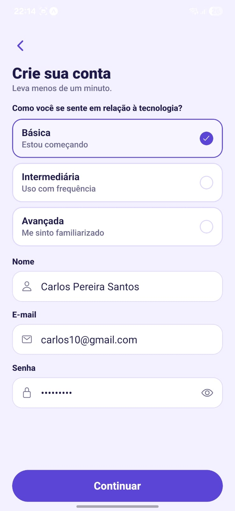
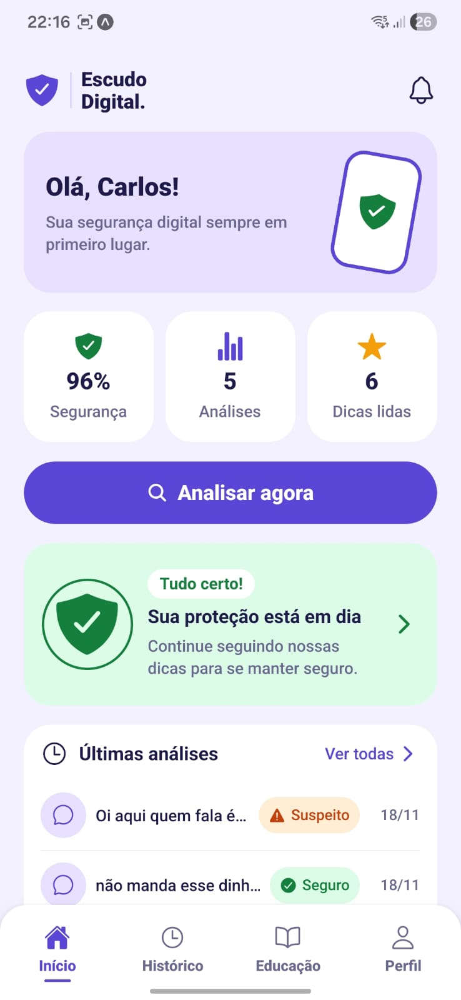
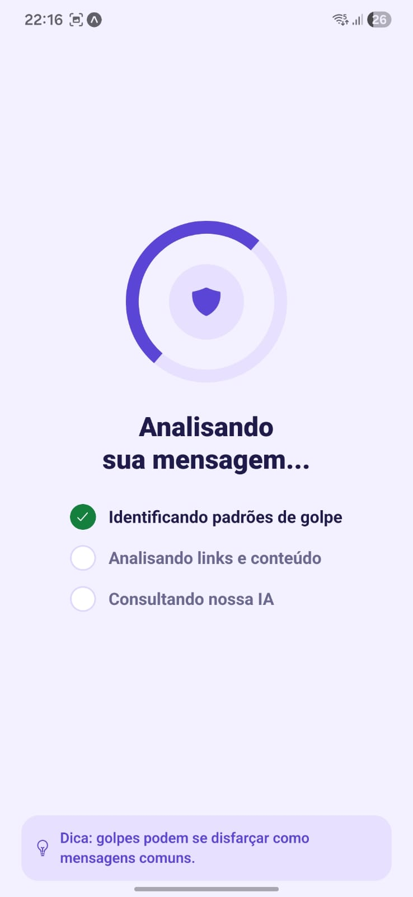

# 🛡️ Escudo Digital

> **Na dúvida, pergunte antes de clicar.**

Aplicativo mobile que usa Inteligência Artificial e Machine Learning para ajudar pessoas a identificar golpes digitais.
O usuário compartilha uma mensagem, um link ou uma imagem suspeita, o app analisa, classifica o nível de risco e
**explica em linguagem simples por que** aquele conteúdo pode ser perigoso.


## 🎯 Objetivo e ODS

Unir tecnologia, prevenção e educação para que as pessoas identifiquem golpes hoje e ganhem autonomia para reconhecê-los amanhã.

- **ODS 4** – Educação de Qualidade
- **ODS 9** – Indústria, Inovação e Infraestrutura
- **ODS 10** – Redução das Desigualdades

## 📱 Telas

| | | |
|:---:|:---:|:---:|
| **1. Boas-vindas**<br> | **2. Cadastro**<br> | **3. Início**<br> |
| **4. Verificação**<br> | **5. Analisando**<br> | **6. Resultado**<br> 
| **7. Histórico**<br> | **8. Educação**<br> | **9. Simulador**<br> 
| **10. Simulador**<br> | **11. Perfil e ajustes**<br> | | |

## ✨ Funcionalidades

- Cadastro e login, com escolha do nível de familiaridade com tecnologia
- Envio de mensagens, links e imagens para análise (com tela de carregamento)
- Classificação de risco: sem risco, atenção, médio risco e alto risco
- Explicação do resultado, adaptada ao nível do usuário
- Histórico de análises com filtros
- Área educativa e simulador de golpes
- Perfil e ajustes (texto maior, privacidade, notificações)

## 🧰 Tecnologias

React Native · Expo SDK 58 · TypeScript (`strict`, sem `any`) · Expo Router · SQLite (`expo-sqlite`) ·
Python · FastAPI · scikit-learn · Tesseract (OCR)

## ✅ Requisitos

- Node.js 22.13+ (exigência do SDK 58)
- Expo Go atualizado para SDK 58 (ou um development build)
- *(Opcional)* Python 3.10+ e Tesseract, para o backend FastAPI

## 🚀 Instalar e rodar o app

```bash
cd escudo-digital
npm install
npx expo install --fix      # alinha as versões de cada pacote ao SDK 58
npx expo start -c
```

Escaneie o QR code com o Expo Go (Android) ou com a câmera (iOS). Outras opções: `npm run android`, `npm run ios`.

Validações: `npm run typecheck` e `npx expo-doctor`.

O app funciona **sozinho**: sem backend, usa o motor de análise local (mock) e a API de conteúdo mock.

## 🔌 Backend FastAPI (opcional)

```bash
cd backend
python -m venv .venv
source .venv/bin/activate        # Windows (Git Bash): source .venv/Scripts/activate
pip install -r requirements.txt
uvicorn main:app --host 0.0.0.0 --port 8000
```

Para o OCR de imagens, instale o Tesseract:
- **Windows:** instalador do projeto UB-Mannheim (marque o idioma Portuguese) e adicione ao PATH
- **Linux:** `sudo apt install tesseract-ocr tesseract-ocr-por`
- **Mac:** `brew install tesseract tesseract-lang`

Depois, na raiz do app, crie um arquivo `.env` (veja `.env.example`) com o IP da sua máquina na rede:

```
EXPO_PUBLIC_API_URL=http://192.168.0.10:8000
```

e reinicie com `npx expo start -c`. Se o servidor cair, o app volta sozinho para o modo local.

### Retreinar o modelo de ML (dataset PhiUSIIL)

```bash
cd backend
python train_model.py caminho/PhiUSIIL_Phishing_URL_Dataset.csv
```

Gera `url_model.joblib` (backend) e `src/data/urlModel.json` (app, modo offline). É uma regressão logística com
14 características calculadas só a partir da URL, com ~98% de acurácia no teste (20%) deste dataset. Como o dataset
favorece domínios simples, a nota do modelo sozinho é limitada a "atenção" e só pesa mais quando combinada com outras regras.

## 🗂️ Estrutura

```
src/
  app/            rotas (Expo Router): boas-vindas, cadastro, login, (tabs)/inicio|historico|educacao|perfil,
                  nova-verificacao, analisando, resultado, simulador, artigo/[id], ajustes/[id]
  components/     Button, AppText, Screen, SegmentedTabs, TextField, RiskBadge...
  constants/      tema, níveis, estilos de risco
  context/        AuthContext, SettingsContext
  db/             SQLite (expo-sqlite): usuários, histórico, dicas lidas
  services/
    analysis/     regras de texto, análise de URL + modelo ML, explicações, OCR simulado
    api/          analysisApi (backend com fallback local), contentApi (mock com latência)
  data/           artigos, dicas, quiz e pesos do modelo (urlModel.json)
  hooks/ types/ utils/
backend/          FastAPI + scikit-learn + Tesseract
docs/screens/     prints do aplicativo
```

## 🏁 Escopo do MVP

Tudo o que o MVP prometia está entregue e funcionando de ponta a ponta:

- ✅ **Cadastro e login** com banco de dados local (SQLite) e senha protegida por hash
- ✅ **Envio de mensagens, links e imagens** para análise, com tela de carregamento animada
- ✅ **Agente de análise** que coordena regras de linguagem, verificação de links e um modelo de Machine Learning
  treinado com o dataset PhiUSIIL (~98% de acurácia nos testes)
- ✅ **Classificação de risco** em quatro níveis, com os motivos que levaram ao resultado
- ✅ **Explicação em linguagem simples**, adaptada ao nível de familiaridade do usuário
- ✅ **Histórico de análises** com filtros
- ✅ **Área educativa** com artigos e **simulador de golpes** para aprender praticando
- ✅ **Leitura de texto em imagens (OCR)** com Tesseract, integrada ao backend FastAPI
- ✅ **Funciona em qualquer cenário:** com ou sem servidor, o app continua analisando

## 🔭 Próximos passos

- Análise contextual de notificações no Android, mediante autorização
- Alertas para familiares
- Conteúdos educativos personalizados
- Modelos de Machine Learning mais avançados

## 👥 Equipe

| Nome | RM |
|---|---|
| Heloísa Fleury Jardim | RM556378 |
| Juan Fuentes Rufino | RM557673 |
| Rickelmyn de Souza Ruescas | RM556055 |
| Paulo Henrique Monteiro Golovanevsky | RM555300 |
| Pedro Henrique Silva Batista | RM558137 |
